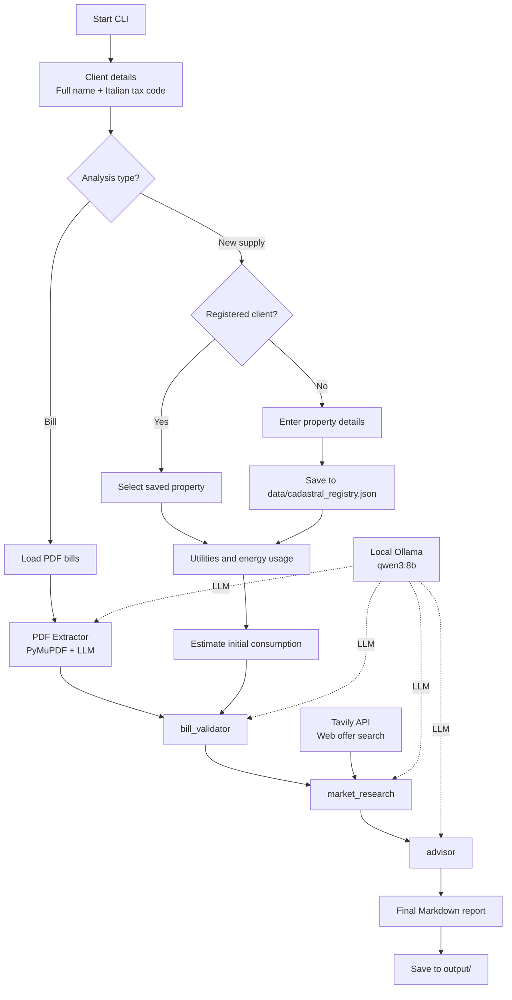

# Agent Bill

An English-language multi-agent system for analyzing Italian electricity and gas bills, comparing energy commodity prices with market offers, and generating advisory reports in Markdown.

## Project Goals

Agent Bill provides structured answers to practical questions:

1. How much am I paying today, and what makes up my bill?
2. Are there better, real and verifiable offers?
3. How much could I save by changing only the energy commodity component?
4. Which offer should I choose for a new home without bills or historical consumption data?

The system is designed to:

- Read actual PDF bills instead of requiring manual entry of bill values
- Estimate an initial profile for new supplies using property details and planned energy usage
- Clearly separate variable costs from regulated costs
- Avoid invented offers: if no verifiable alternatives are available, state this explicitly

## Scope

Supported:

- Electricity bills
- Gas bills
- Per-client analysis, with support for multiple properties
- New supplies without existing bills, for electricity, gas or both

Not supported:

- Advanced OCR for image-only PDFs (scanned documents without text)
- Direct integration with provider portals
- Binding contractual quotes: consumption and costs for new supplies are indicative estimates

## Architecture

The project uses a multi-agent pipeline orchestrated with LangGraph.

Node sequence:

1. bill_validator
2. market_research
3. advisor

The graph is defined in `src/agent_bill/graph/workflow.py`.

## Architecture Diagram



Ollama runs all LLM processing locally. Tavily is the only required external service
and is used exclusively to search for offers and prices on the web.

### 1) Bill Validator

Responsibilities:

- Receive structured bill data
- Build the consumption profile
- Highlight anomalies and check data consistency

Main inputs:

- Bills parsed from PDFs
- Property details (if available)

Main outputs:

- Validation notes
- Aggregated consumption profile

### 2) Market Research

Responsibilities:

- Run web searches through Tavily
- Compare only the energy commodity component
- Include only offers with verifiable data

Key rules:

- No placeholders such as Provider A or fictional URLs
- Explicitly state when no verifiable better offer was found

### 3) Advisor

Responsibilities:

- Generate the final Markdown report
- Summarize the current situation, cost breakdown, market comparison and recommendation
- Calculate savings only on the energy commodity component, keeping network costs, system charges and taxes unchanged

## New Supply Without Bills

Select `new-supply` at startup. In this mode, the system:

1. Requests or retrieves the property's cadastral details
2. Asks which utilities to activate and the planned sources for heating and hot water
3. Accepts known annual consumption or estimates it from floor area, occupants and energy rating
4. Searches for real offers matching the estimated profile and compares them

Since there is no previous supply, the report does not calculate historical savings or create
a bill breakdown. Projected consumption is always labeled as an estimate. If the energy rating
is unknown, a conservative assumption is used and explicitly stated in the report.

## Key Calculation Distinction

The system distinguishes two different metrics:

- Energy commodity price: unit price of the energy component alone
- All-inclusive total unit cost: total bill amount divided by consumption

This distinction prevents misleading interpretations when comparing market offers.

## Technology Stack

- Python 3.12+
- LangGraph
- LangChain + langchain-ollama
- Ollama with the local qwen3:8b model
- Tavily API for web search
- PyMuPDF for PDF text extraction
- Pydantic for data models
- Rich for the CLI

## Project Structure

- `src/agent_bill/main.py`: CLI entry point
- `src/agent_bill/models/analysis.py`: analysis modes and new supply requirements
- `src/agent_bill/graph/`: shared state and multi-agent workflow
- `src/agent_bill/agents/`: agent nodes
- `src/agent_bill/tools/pdf_extractor.py`: PDF bill parsing
- `src/agent_bill/tools/web_search.py`: offer and price searches via Tavily
- `src/agent_bill/tools/cadastral_registry.py`: local client/property registry
- `src/agent_bill/models/`: Pydantic models
- `tests/`: automated tests
- `output/`: generated reports
- `data/cadastral_registry.json`: local cadastral registry

## Client Management and Property Registry

### Local Data and Publishing

The repository includes only an empty example registry:
`data/cadastral_registry.example.json`. The working registry,
`data/cadastral_registry.json`, is created automatically on first use.

Data in `data/`, reports in `output/`, PDFs, `.env` files containing secrets and
local caches are excluded from Git. Do not put clients' personal data in tests,
documentation or other versioned files: use fictional data only.
The `.env.example` file must contain only demonstration values.
Before publishing, review staged files with `git diff --cached`.
Ignore rules do not remove files already present in Git history.

At startup, the system asks for:

- Full name
- Italian tax code

Using these details, it:

1. Looks up any properties already registered
2. Lets you select an existing property to reuse
3. If none are available, asks for property details and saves them to the registry

### Property Identifier

The `property_id` field is built from:

- Normalized full address
- Municipality
- Province

Typical format:

- `example-street-10__milan__mi`

This approach uses readily available data and produces readable, stable identifiers
that distinguish multiple properties belonging to the same client. Existing local
records remain readable; their saved values are not automatically translated.

## Configuration

Set these variables in `.env`:

- `OLLAMA_BASE_URL` (optional, default: `http://localhost:11434`)
- `OLLAMA_MODEL` (optional, default: `qwen3:8b`)
- `TAVILY_API_KEY`

An example is available in `.env.example`.

Ollama does not require tokens or API keys. The previous `GITHUB_TOKEN` and
`GITHUB_MODELS_MODEL` variables are no longer used and can be removed from the local `.env`.

## Installing Ollama

1. Install [Ollama for Windows](https://ollama.com/download/windows)
2. Open a new terminal after installation
3. Download the configured model:

```powershell
ollama pull qwen3:8b
```

The desktop application normally starts Ollama in the background. To start it manually
if it is not already running:

```powershell
ollama serve
```

Check that the service and model are available:

```powershell
ollama list
Invoke-RestMethod http://localhost:11434/api/tags
```

`qwen3:8b` requires approximately 6-8 GB of available memory. On machines with fewer
resources, use a smaller model such as `qwen3:4b`, using the same model name in both
`ollama pull` and `OLLAMA_MODEL`. A smaller model may reduce the accuracy of bill data extraction.

## Quick Start

1. Install Ollama and download the model
2. Create and activate a Python virtual environment
3. Install the project in editable mode
4. Configure `.env`
5. Make sure Ollama is running
6. Start the CLI

```powershell
python -m pip install -e .
Copy-Item .env.example .env
python -m agent_bill.main
```

If `.env` already exists, do not overwrite it: add `OLLAMA_BASE_URL` and `OLLAMA_MODEL`,
keep `TAVILY_API_KEY` and remove the old GitHub Models variables.

## Output

The final report is displayed in the terminal and, if confirmed, saved in `output/` as:

- `report_firstname_lastname_YYYY-MM-DD.md`

## Quality and Tests

The test suite is available in `tests/test_energy_calc.py`.

Run it with:

```powershell
python -m pip install -e ".[dev]"
python -m pytest tests/ -v
```

## Operational Notes

- If Ollama is not running, LLM calls fail with a connection error to `localhost:11434`
- If the configured model has not been downloaded, run `ollama pull <model-name>`
- If Ollama runs on another host or port, update `OLLAMA_BASE_URL` in `.env`
- The first request may be slower because Ollama needs to load the model into memory
- With a local Ollama endpoint, bill text and LLM prompts stay on the machine; offer search queries are sent to Tavily
- Reliable market research depends on the quality of web results available at execution time
